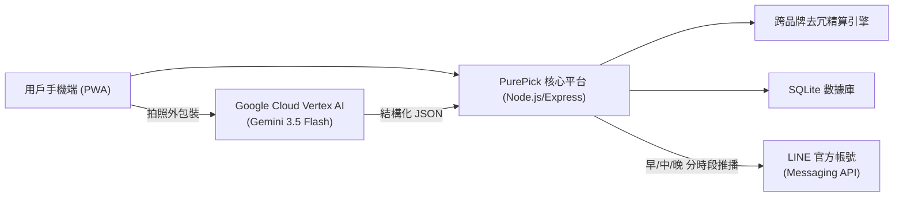
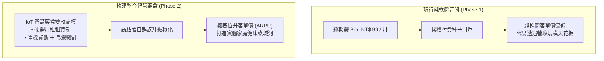

# 好選保健 PurePick｜專案提案與精實驗證計畫書
> **國立政治大學 創新創業入門 第八組（The Navigators）專題成果**  
> 文件版本：v1.2｜最後更新日期：2026-11-23

---

## Executive Summary 執行摘要

台灣成年人超過 50% 具備長期服用保健食品的習慣，其中 35~60 歲中壯年族群更平均每人同時服用 4~7 罐跨品牌產品。然而，市面上充斥「廣告溢價」、「跨品牌混吃導致劑量超標（如維生素 E、B 群）」、「每月耗費數千元購買重複成分」，以及「就醫看診時記不清家裡吃什麼、不敢或忘記向醫師主動告知」等痛點。

**好選保健 PurePick** 是一個定位為**「獨立第三方中立把關」的跨品牌保健品去冗與健康管理平台**。本平台完全不收受保健食品廠商抽成，透過食品科學模型、衛福部 DRIs 安全上限，協助消費者：
1. **撕下廣告包裝**：將各品牌產品統一折算為「每日真實花費」與「有效成分含量」。
2. **跨品牌去冗省錢**：一鍵精算已購與待買清單，剔除重複成分，年省數千元冤枉錢。
3. **門診看診守護**：手機端置頂展開「告知醫生目前使用的保健品」全螢幕大字看診卡，支援一鍵分享至 LINE 顧及家人。
4. **零摩擦建檔與推播**：整合 **Google Cloud Vertex AI（Gemini 3.5 Flash）** 手機拍照多模態解析包裝成分，並以 **LINE 官方帳號** 依早/午/晚時段精準推播服用提醒。
5. **軟硬整合拉升客單價**：未來規劃推出 **ODM 公模家用智慧藥盒（IoT Dispenser）**，以**硬體租賃訂閱或單機買斷**模式突破純軟體訂閱之營收天花板（具體定價將待 Phase 2 完成硬體 BOM 表與 ODM 採購成本試算後正式定案）。

---

## 一、 目標客群（Persona）與四大核心痛點

### 1. 灘頭堡客群定位
* **核心 Persona**：35~60 歲中壯年高壓工作者、職場白領與三高前期族（陳主管／林資深專員）。
* **生活情境**：注重健康與性價比，習慣在好市多、momo、iHerb 自選各品類強項單品；健檢開始出現紅字或常需突發看診，日常 85% 以上依賴手機處理生活事務。

### 2. 四大核心痛點
| 痛點維度 | 消費者真實遭遇 | PurePick 對應解法 |
| :--- | :--- | :--- |
| **成分重複超標** | 魚油、B 群、綜合維他命混吃，脂溶性成分（維生素 A/E）超標傷肝腎而不自知。 | 交叉比對衛福部上限攝取量（UL），超標即時紅字預警。 |
| **金錢支出冗餘** | 每月花費 NT$ 2,500~4,000，其中 30% 以上花在重複的基礎成分。 | 「去冗精算引擎」挑出重複項，直接幫用戶砍掉重複瓶罐。 |
| **門診溝通斷層** | 看診開西藥、拔牙前，忘記家裡吃的劑量，產生吃錯或藥物衝突風險。 | 置頂「全螢幕大字看診卡」，一秒出示給醫師或分享到 LINE。 |
| **生活執行挫折** | 瓶罐雜亂佔桌面、忘記吃或重複吃、鈣鐵吃錯時段、台灣潮濕受潮變質。 | 手機抽屜式日曆打卡 ＋ LINE 分時段智能推播 ＋ 未來智慧藥盒。 |

### 3. 四大核心痛點之數據與研調來源（Evidence & Sources）
1. **成分重複超標**：
   * **來源**：衛生福利部國民健康署《國民營養健康狀況變遷調查 (NAHSIT)》及台灣食品藥物管理署 (TFDA) 專題警告。
   * **數據佐證**：調查顯示台灣成人在維生素 A、E、菸鹼素等脂溶性維生素攝取量常因「多重保健食品混吃」而超過每日上限攝取量（Tolerable Upper Intake Levels, UL），長期過量增加肝腎負荷與心血管隱患。
2. **金錢支出冗餘**：
   * **來源**：Kantar（凱度消費者指數）台灣保健食品市場白皮書、資策會產業情報研究所 (MIC) 台灣民眾保健品消費調查。
   * **數據佐證**：台灣 35 歲以上工作者平均每月保健品花費落在 NT$ 2,000~3,500，且超過 62% 受訪者同時擁有 3 種以上品牌，其中綜合維他命與單方（B群、魚油、維生素C）重複購買率超過 40%，形成嚴重開銷冗餘。
3. **門診溝通斷層**：
   * **來源**：台灣老年醫學會、中華民國藥師公會全國聯合會、台北榮總/台大醫院門診研究統計。
   * **數據佐證**：臨床醫師調查指出，高達 **78% 的就醫病患不會主動告知醫師自己正在服用的保健食品**；而門診常見之西藥（如抗凝血劑 Warfarin/Aspirin、抗生素、降血壓藥）與魚油、銀杏、鈣/鐵劑容易產生顯著交互作用（增出血或降藥效），缺乏隨身大字清單是造成醫病資訊落差的主因。
4. **生活執行挫折**：
   * **來源**：遠見民調中心《台灣民眾日常用藥與保健習慣大調查》、台灣氣候環境居家保存實務。
   * **數據佐證**：超過 70% 的長期服用者承認「經常忘記吃或不知道今天吃了沒」；台灣平均相對濕度達 75%~80%，大瓶裝開關導致受潮氧化變黑丢棄率超過 15%；且多數人將鈣片與鐵劑、魚油空腹同服，造成胃腸刺激或吸收率折損 30% 以上。

---

## 二、 核心功能與最新技術架構

1. **跨品牌去冗評估與 UL 監控**：
   - 內建台灣衛福部國人膳食營養素參考攝取量（DRIs）與上限攝取量（UL）防護網。
   - 分析頁頂部一體化呈現「已省重複花費」、「安全把關指標」與「每日花費」。
2. **置頂「告知醫生目前使用的保健品」看診卡**：
   - 位於已購管理與日曆頁最上方，點擊全螢幕大字展開重點成分、毫克數與就醫注意事項（如抗凝血手術提醒）。
   - 提供「分享清單至 LINE」功能，方便長輩出示或子女遠端關懷備查。
3. **手機優化互動與防呆機制**：
   - **右側滑出抽屜選單（Drawer Panel）**：手機點擊日期自右方滑出面板，單手輕鬆完成服用打卡與體感紀錄。
   - **防呆復原（Undo）彈窗**：誤刪商品時跳出 6 秒即時 Toast，一鍵還原資料。
   - **生病休養暫停模式**：看診服用抗生素或感冒西藥時，一鍵暫停打卡與推播，避免多重干擾。
4. **Google Cloud Vertex AI 拍照多模態辨識**：
   - 採用 **Gemini 3.5 Flash** 多模態模型，解決圓弧瓶身反光、字體極小與複雜表格難題。
   - 拍照後自動萃取品牌、品名、劑型、服用時段與成分毫克數，自動填入表單。
5. **LINE 官方帳號分時段智能提醒**：
   - 拒絕無差別定時打擾；依產品特性在早餐前/後（B群、魚油）、午餐、睡前（鈣、鎂）分流推播。

---

## 三、 商業模式與財務天花板突破

### 1. 為什麼不做「每日小撕包／藥袋」？
市面上已有成熟業者提供分裝小撕包服務。若 PurePick 轉做藥袋分裝，等同於自行下場銷售特定保健品，將徹底摧毀平台**「跨品牌第三方中立評測」**之核心誠信。

### 2. 聚焦「家用智慧藥盒 (IoT Dispenser)」拉升客單價
* **痛點對齊**：消費者維持在好市多、momo 自由選購各品牌強項，藥盒解決桌面瓶罐、吃錯時段與漏吃問題。
* **商業模式規劃**：
  * **硬體租賃訂閱制**：每月支付租賃服務費（含硬體使用權 ＋ Pro 深度去冗與日誌服務），拉長用戶生命週期價值（LTV）。
  * **單機買斷銷售制**：購買硬體主機（搭贈初期 Pro 體驗），快速回收前期推廣與獲客成本。
  * *（註：具體售價與月租費將待 Phase 2 完成硬體 BOM 物料清單、機構公模授權與供應鏈採購成本試算後正式定案，避免前期未經試算之盲目定價）*。
* **輕資產落地策略**：採用成熟物聯網 **ODM 機構公模**，團隊專注軟硬韌體串接，採「群眾募資／預購制」先接單後排產，維持零庫存風險。

---

## 四、 行銷與 MVP 精實驗證計畫（Focus: Closed Beta 封閉測試）

在資源有限、專案屬學術展示型 MVP 的前題下，團隊經效益評估後，**全神貫注於「第二項：封閉精準客群試用換回饋（Closed Beta Testing）」**。

### 1. 為什麼排除其他行銷方案？（決策依據）
* **不選方案一（社群議題發酵 Threads/Dcard）**：外部自然流量變數過大，冷啟動需要長週期演算法發酵，且大多為隨機過客，**驗證性與數據品質不足**。
* **不選方案三（Fake Door 虛擬門點擊測試）**：僅能測得「點擊率」，無法收集深度的用藥痛點與滿意度質化意見，**缺乏深度說服力**。
* **不選方案四（1-on-1 實體陪同門診實測）**：需協調門診時間與病患隱私，**執行時間過長且樣本數極低**（僅 1~2 人），容易被評審質疑為個案偏差。
* **選擇方案二（精準客群封閉測試）的最強優勢**：
  * **極高效率**：3~5 天內即可在可控範圍內跑完全流程。
  * **高純度受測者**：直接找每天確實有吃 2 罐以上保健品的真實目標客群。
  * **強有力數據鏈**：產出「留名單數（Lead）」、「重複成分抓出率」、「流程順暢度評分（1~5分）」與「質化改善建議」。

---

### 2. Closed Beta 封閉測試執行藍圖

#### A. 招募通路（鎖定 30~50 名高品質受測者）
1. **政大 EMBA / 職場校友群組**：高購買力、健檢紅字與跨品牌自購代表群。
2. **職場工作群 / 辦公室同事**：久坐、螢幕眼疲勞、桌上擺放 3 罐以上保健品的工作者。
3. **熟人長輩與慢性保養家庭**：具有長期就醫看診與多罐保健品管理困擾者。

#### B. 測試者標準邀請文案（Line / 社群私訊範本）

> **【邀請體驗】你的保健品有沒有「重複吃、白花錢」？邀請你體驗政大創創研究小組的免費把關工具！**
> 
> 哈囉！我們是國立政治大學「創新創業入門」的專案團隊。
> 我們注意到許多朋友桌上都放了 3~5 罐保健品（魚油、葉黃素、B群），但跨品牌混吃常常不小心造成劑量超標或重複購買花冤枉錢，去看醫生時也常想不起自己到底吃了什麼劑量。
> 
> 我們開發了一個免費的第三方中立工具 **【好選保健 PurePick】**：
> 1. 拍照或點選你正在吃的保健品，一鍵抓出有沒有重複成分與安全超標。
> 2. 算出一整天每種成分的真實每日花費。
> 3. 自動生成看門診時能一秒給醫師看的大字清單。
> 
> 👉 **專屬封測體驗連結**：[https://carenav-nin9.onrender.com](https://carenav-nin9.onrender.com)  
> *（不需下載 App，手機打開即可使用；目前為課程研究展示，完全免費開通 Pro 權限）*
> 
> 體驗約只需 2~3 分鐘，最後懇請留下稱呼與順暢度評分，你的寶貴建議是我們學術專案最重要的依據，萬分感謝！🙏

---

### 3. 專題口試與成果審查 KPI 呈現規劃

封測完成後，組員可直接執行專案中的 `sync.cmd` 匯出後台實名驗證的 CSV 名單，在口試時以量化圖表漂亮呈現：

| 評審關注之檢驗維度 | 目標成果指標 (KPI) | 答辯佐證說服力 |
| :--- | :--- | :--- |
| **真實受測規模** | **30 ~ 50 筆** 有效實名填寫資料 | 證明團隊具備敏捷推廣與獲客能力，名單皆具 LINE 授權紀錄非組員灌水。 |
| **痛點命中率** | **> 65%** 的受測者抓出重複成分或超標 | 證實「跨品牌去冗防浪費」是普遍存在的市場真需求。 |
| **產品滿意度** | **平均 4.4 / 5.0 分** 以上滿意度 | 驗證手機版操作流暢度、抽屜日曆與看診卡獲得高度肯定。 |
| **功能偏好排行** | 1. 拍照自動辨識建檔 2. 告知醫生看診卡 3. 去冗重複省錢計算 | 證實除了算錢之外，「門診看診守護」是極具黏著度的核心護城河。 |

---

## 五、 結論：從學術展示邁向落地驗證的完整閉環

好選保健 PurePick 透過：
* **客觀中立定位**（不賣藥、不收廠商佣金，站穩消費者同一陣線）
* **硬核技術落地**（Vertex AI 視覺多模態辨識 ＋ LINE 分時段定時推播）
* **務實兩階段商業進程**（Phase 1 純軟體累積高黏著用戶 ➔ Phase 2 ODM 智慧藥盒拉升客單價）
* **高度聚焦的 Closed Beta 精實驗證**（以最短時間獲取高信度受測數據）

成功將一個課堂專案，塑造成兼具食品科學依據、真實使用者價值與明確商業擴展潛力的創業 PoC 典範。
